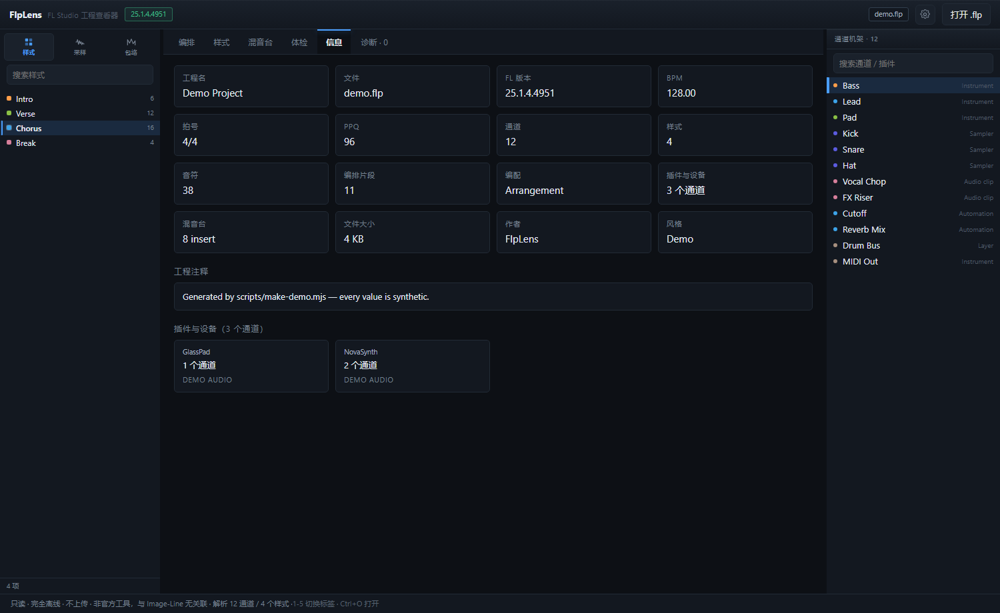
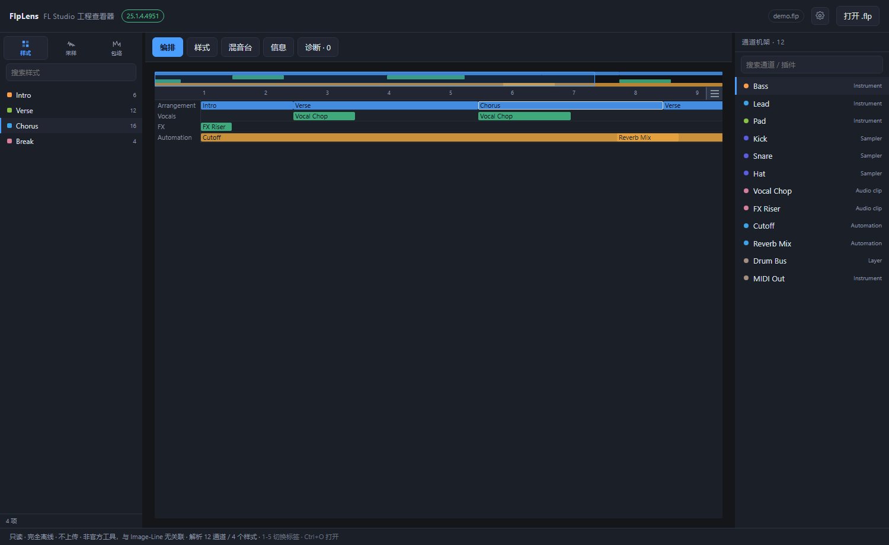
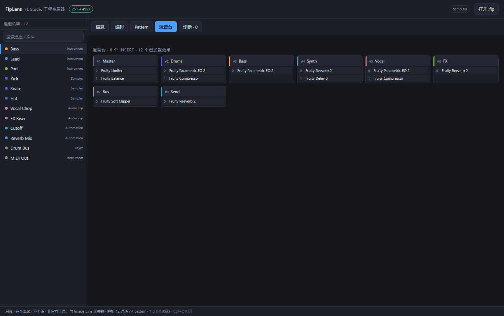

# FlpLens

**只读、离线、纯前端的 FL Studio 工程查看器。**

打开一个 `.flp`，看工程结构、编排、通道机架、MIDI 音符、混音台和插件清单——不需要安装 FL Studio，不需要联网，文件不上传。

> 非官方工具，与 Image-Line 无关联。不修改、不写回、不转换工程文件。







---

## 支持范围

| FL 版本 | 状态 |
|---|---|
| **FL Studio 2025（25.x）** | ✅ 已验证：60 个本机工程，0 解析失败，通道数与 header 全部一致 |
| FL 2024 / 21 / 20 | ⚠️ 只读元数据，结构区留空，UI 标"未验证版本" |
| FL 2026（26.x） | ⚠️ 有档案但无样本，未验证 |

## 能看什么

- **工程信息**：名称、作者、BPM、拍号、PPQ、FL 版本、编配名、时间标记、文件大小
- **通道机架**：名称、类型（采样器 / 乐器 / 音频剪辑 / 自动化）、原始颜色、宿主 VST 的名称与厂商；支持按名称/插件/类型搜索
- **编排**：按编配切换，pattern / 音频 / 自动化三类剪辑分层着色，轨道名，可点击跳到对应 pattern
- **钢琴卷帘**：选中 pattern 的音符缩略图，按通道交替着色
- **混音台**：127 个 insert 的名称、颜色、每个 slot 的效果器链与厂商
- **诊断**：逐条列出解析问题，可一键复制**不含工程内容**的诊断报告

## 不做什么

- 不写回、不改版本、不做降级
- 不解析第三方 VST 的预设名或参数状态（只显示插件名 / 厂商 / 路径）
- 不做音频波形、不做播放、不做渲染
- 不内置示例工程，不收集任何数据

## 用法

### 最快：双击单文件

```bash
npm install
npm run build
```

然后双击 **`dist/flplens.html`**——单文件，250 KB，不需要服务器、不需要联网，拷到任何电脑都能开。

### 开发

```bash
npm run dev        # http://localhost:5173
npm run build:web  # 普通多文件构建（需要 HTTP 托管）
npm test           # 单元测试（合成 fixture，不依赖任何音乐文件）
npm run verify     # 批量回归：跑本机 .flp，断言通道数与 header 一致
```

`npm run verify` 默认扫描 `~/Documents/Image-Line`，可用 `FLP_DIR` 覆盖。

## 怎么用

1. 把任意 `.flp` **拖进窗口**（随时可以再拖一个替换当前的），或者点右上角「打开 .flp」
2. 左侧通道列表可搜索
3. `1`–`5` 切换标签，`Ctrl+O` 打开文件
4. 编排里点蓝色 pattern 剪辑，下面钢琴卷帘会跳到那个 pattern

顺带也能打开 `.fst` / `.fsc`（FL 的状态文件，同一个容器格式）——那种文件只包含单个通道/预设，所以界面上只会有一个通道。

**打不开的文件不会顶掉你正在看的工程**：解析失败会在顶部显示红色提示条，原工程保持不动。

## 快捷键

| 键 | 作用 |
|---|---|
| `1`–`5` | 信息 / 编排 / Pattern / 混音台 / 诊断 |
| `Ctrl+O` | 打开文件 |

## 性能

在一台普通 Windows 机器上，46 MB / 322 通道 / 135 pattern / 8099 音符 / 3673 片段 / 127 insert 的工程：

| 阶段 | 耗时 |
|---|---|
| 上传 → 首屏可交互 | **56 ms**（含 `File.arrayBuffer()` + 解析 + 渲染） |
| 切到编排（渲染 3564 个剪辑） | **91 ms** |
| 切到混音台（117 个 insert / 167 个效果） | **50 ms** |
| 解析本身（Node，60 个文件） | 中位 0 ms，p95 5 ms，max 9 ms |

## 隐私

解析全部在浏览器内存里完成。没有网络请求，没有上传，没有遥测。

「复制诊断报告」只包含：文件大小、FL 版本、header 字段、问题列表、事件 ID 直方图。
**不含**工程名、通道名、采样路径、音符。

## 技术

- 解析层 `src/flp/` 是**零运行时依赖**的 TypeScript，单遍扫描事件流
- **事件长度表与语义表分离**：`events.ts` 存跨版本稳定的含义，`profiles.ts` 存会变的长度/编码
- playlist 记录长度不查版本表，靠 `pattern_base == 20480` 签名探测（32 / 60 / 80 / 88 字节都能读）
- 颜色按 `0x00BBGGRR` 解码（由合成 fixture 验证）
- 混音台以 `InsertFlags(236)` 为 insert 边界——insert 名是可选的，不能拿它当边界

```text
src/flp/stream.ts        字节流 / varint / 文本解码
src/flp/events.ts        事件 ID 语义表
src/flp/profiles.ts      版本档案（fl25 已验证）
src/flp/diagnostics.ts   Issue 收集与报告
src/flp/project.ts       状态机：事件流 → Project
```

## 想先看看效果？

仓库里带了一个**完全虚构**的演示工程：[`docs/demo.flp`](docs/demo.flp)（3.4 KB，12 通道 / 4 pattern / 11 片段 / 8 insert）。
拖进应用就能看到上面三张截图里的样子——它由 `scripts/make-demo.mjs` 从零字节生成，不含任何人的音乐。

## 测试

```bash
npm test        # 15 个单元测试，全部跑在合成 fixture 上
npm run fixture # 重新生成 test/fixtures/minimal/sample.flp
npm run demo    # 重新生成 docs/demo.flp
```

`scripts/make-fixture.mjs` 从零字节构造一个结构合法的 `.flp`（367 字节），因此测试不依赖任何人的音乐文件，也不需要 FL Studio。

`scripts/make-fixture.mjs` 从零字节构造一个结构合法的 `.flp`（367 字节），因此测试不依赖任何人的音乐文件，也不需要 FL Studio。

## 许可证

MIT。第三方依赖保留各自许可。

解析规则参考了公开的格式研究（flpkit / PyFLP / ling-daw / flp-file），但代码为独立实现。
PyFLP 与 jsflp 是 GPL-3.0，本仓库不含它们的代码。

## 贡献

见 [CONTRIBUTING.md](CONTRIBUTING.md)——遇到打不开的工程，贴诊断报告即可，不需要读源码。
